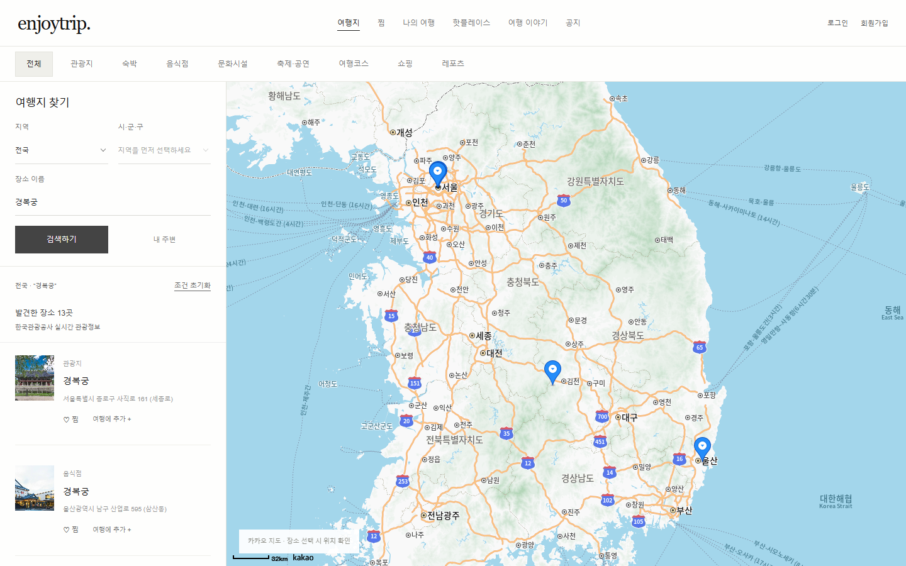
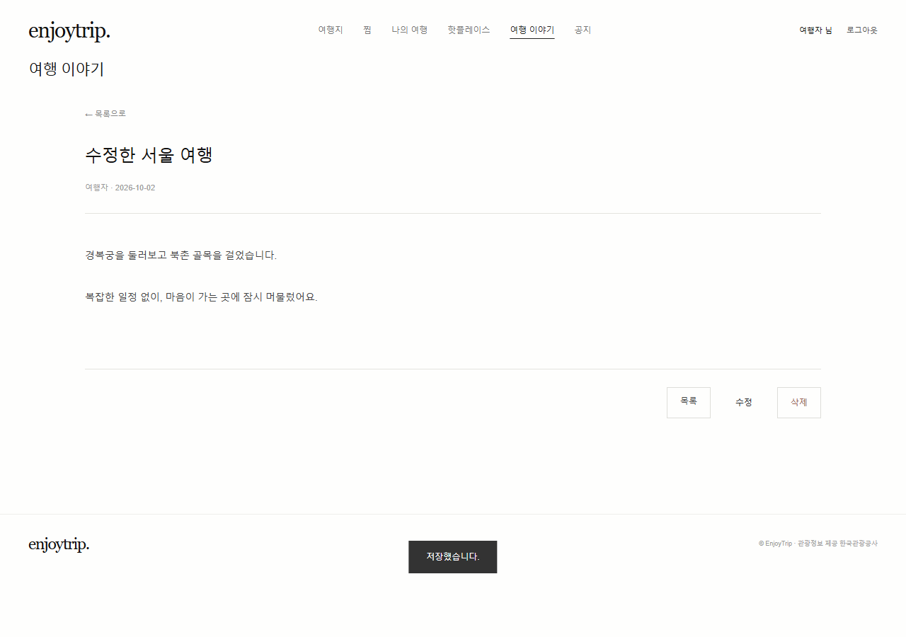

# EnjoyTrip

국내 여행지를 지도에서 찾고, 찜한 장소로 여행계획을 만드는 프론트엔드 프로젝트입니다. SSAFY 자바전공 EnjoyTrip 프론트 과제의 HTML·CSS·JavaScript 요구사항을 기준으로 구현했습니다.

- 서비스: [enjoytrip.pages.dev](https://enjoytrip.pages.dev/)
- GitHub: [jayyeong/enjoytrip](https://github.com/jayyeong/enjoytrip)
- SSAFY GitLab: [aia1235/enjoytrip](https://lab.ssafy.com/aia1235/enjoytrip)

## 화면과 사용 흐름

메인은 지도 중심입니다. 위에서 관광 유형을 선택하고, 왼쪽에서 지역·시군구·장소 이름을 검색합니다. 모바일에서는 지도와 결과 목록을 함께 보고 필터를 펼칠 수 있습니다.

1. 장소 이름이나 지도 마커를 눌러 상세 정보를 확인합니다.
2. 마음에 드는 장소는 로그인 없이 찜할 수 있습니다.
3. 여행에 추가하면 로그인 후 선택한 장소가 이어서 추가됩니다.
4. 나의 여행에서 순서·날짜·경비·메모를 정하고 저장합니다. 초안은 자동 보관되며 기존 계획을 불러와 수정할 수 있습니다.
5. 찜 목록에서 장소 소개를 누르면 Hotplace 이름과 주소가 자동 입력됩니다.
6. 게시판과 공지사항은 목록·글쓰기·상세·수정을 같은 페이지에서 표시합니다. 글 주소로 다시 열기와 브라우저 뒤로 가기를 지원합니다.




## VS Code에서 실행

이 프로젝트는 Java 서버가 없는 **프론트엔드 과제**입니다. Python은 HTML 파일을 제공하는 로컬 서버로만 사용합니다.

```powershell
git clone https://lab.ssafy.com/aia1235/enjoytrip.git
cd enjoytrip
Copy-Item 01_api/js/keys.example.js 01_api/js/keys.js
python run.py
```

브라우저에서 `http://localhost:8001`을 엽니다. VS Code Live Server로 `index.html`을 실행해도 됩니다. ES 모듈과 암호화 API를 사용하므로 파일을 더블클릭해서 실행하지 않습니다.

### API 설정

복사한 `01_api/js/keys.js`의 두 상수를 본인 키로 채웁니다.

| 설정 | 내용 |
|---|---|
| `DATA_GO_KR_API_KEY` | 공공데이터포털 한국관광공사 국문 관광정보 서비스 일반 인증키 |
| `KAKAO_MAP_KEY` | 카카오 개발자 콘솔의 JavaScript 키 |

카카오 앱에서 지도 기능을 활성화하고 실제 실행 주소를 허용 도메인으로 등록합니다. Live Server 포트가 바뀌면 해당 주소도 등록해야 합니다. 빈 키로 실행하면 관광정보는 샘플 모드로 표시되고 지도 연결 안내가 나옵니다.

키 파일은 Git에서 제외합니다. Cloudflare 빌드에서는 같은 이름의 환경변수를 사용합니다. 브라우저에서 호출하는 API 키는 배포된 JavaScript에서 확인할 수 있으므로 카카오 허용 도메인과 API 쿼터를 설정해야 합니다.

## 요구사항 구현 범위

| 번호 | 요구사항 | 구현 내용 |
|---|---|---|
| F101 필수 | 지역별 관광정보 | 실제 API 조회, 지역·시군구 필터, 지도·상세·더 보기 |
| F102 필수 | 관광지·숙박·음식점 | 상단 유형별 검색 |
| F103 필수 | 문화시설·공연·코스·쇼핑 | 유형별 검색, 레포츠 포함 |
| F107 필수 | 회원 관리 | 가입·조회·수정·탈퇴, 중복 아이디·이메일 검사 |
| F108 필수 | 로그인 관리 | 로그인·로그아웃·학습용 비밀번호 재설정 |
| F104 추가 | 여행계획 | 장소 순서, 드래그·이동 버튼, 날짜·경비·메모, 초안·저장·수정·삭제 |
| F105 추가 | Hotplace | 선택적 사진, 방문일·유형·주소·소개, 지도 연결·본인 글 삭제 |
| F109 심화 | 공지 CRUD | 페이지 내 목록·상세·작성·수정·삭제 |
| F110 심화 | 게시판 CRUD | 페이지 내 목록·검색·상세·작성·수정·삭제 |
| 추가 UX | 찜 | 비회원 찜, 저장 유지, 여행·Hotplace 연결 |
| F106·F111~114 | 뉴스·날씨·추천 사진·일출·충전소 | 미구현 선택 기능 |

필수 기능은 브라우저 저장을 사용하는 프론트엔드 시연 범위로 구현했습니다. 서버·DB 기반의 실제 회원 인증과 사용자 간 공유는 포함하지 않습니다.

## 기술과 데이터

HTML5, CSS3, JavaScript ES Modules, Bootstrap 5.3.3, Kakao Maps JavaScript SDK를 사용합니다. Node.js 22 이상은 정적 검사와 배포 파일 생성에 사용하며 별도 npm 패키지 설치가 필요 없습니다.

한국관광공사 `https://apis.data.go.kr/B551011/KorService2`를 사용합니다.

| API | 용도 |
|---|---|
| `ldongCode2` | 법정동 시군구 코드 |
| `areaBasedList2` | 지역·유형별 관광정보 |
| `searchKeyword2` | 장소 이름 검색 |
| `locationBasedList2` | 현재 위치 반경 2km 검색 |
| `detailCommon2` | 장소 개요와 공통 상세 |

인증키를 한 번 디코딩한 후 요청 URL에 인코딩합니다. 요청 시간 초과, 빈 결과, 실패 안내를 처리합니다. 실패 시 예시 데이터를 실제 조회 결과와 구분해 표시합니다. 지도에는 좌표 기반 마커를 표시하고 좌표가 없으면 주소 검색을 시도합니다. 경로 순서는 방문 순서이며 실제 도로 길찾기 결과가 아닙니다.

## 저장과 제한

회원·여행계획·초안·Hotplace·게시글·찜은 현재 브라우저의 `localStorage`, 로그인 상태는 탭의 `sessionStorage`에 저장합니다. 브라우저 저장소를 지우거나 다른 기기에서 접속하면 같은 데이터를 볼 수 없습니다. 찜은 계정별이 아닌 현재 브라우저 공용 목록입니다.

비밀번호는 무작위 salt와 SHA-256으로 저장하지만 클라이언트 저장과 권한 검사는 학습용입니다. 비밀번호 재설정도 아이디·이메일 확인 방식이며 실제 이메일 인증은 없습니다. 공지 작성에 별도 관리자 역할은 없습니다. 실서비스에는 서버 인증·DB·권한 검사가 필요합니다.

사진은 PNG/JPEG/WebP 2MB 이하입니다. 저장 공간이 부족하면 안내합니다. 회원 탈퇴 시 개인 계획과 초안을 삭제하고 남은 공개 글의 작성 권한을 해제합니다.

## 구조

```text
index.html                 화면과 페이지 영역
css/style.css              공통 디자인·반응형 레이아웃
js/main.js                 검색·회원·여행·찜·게시판 흐름
js/select.js               키보드 조작 가능한 선택 메뉴
js/api.js                  관광정보 API 요청
js/data.js                 지역·유형·샘플 데이터
01_api/js/kakao.js         지도 SDK·마커·주소 검색
01_api/js/keys.example.js  로컬 키 설정 템플릿
run.py                     로컬 정적 서버
scripts/                   정적 검사·배포 빌드
.github/workflows/ci.yml    GitHub Actions 검사
 docs/screenshots/          기능 화면 캡처
```

## 검사와 배포

```powershell
npm run check
npm run build
```

`dist/`에 배포 파일을 생성합니다. 키·원본 기획서·개발 임시 파일은 Git에 포함하지 않습니다.

GitHub Actions는 push/PR에서 검사와 빌드를 실행합니다. Cloudflare Pages는 GitHub의 `design/kuad-reference` 브랜치 push를 감지해 독립적으로 `npm run build`를 실행하고 `dist/`를 배포합니다. Actions 성공이 Cloudflare 배포를 차단·승인하는 구조는 아닙니다. `ux/usability-improvements`에서 검증한 변경을 배포 브랜치에 병합합니다. GitLab은 제출용 저장소이며 현재 Cloudflare 자동 배포 대상은 GitHub입니다.

최종 점검에서는 게시판·공지 CRUD와 직접 주소/뒤로 가기, 찜 유지, 로그인 후 작업 이어가기, 탈퇴 후 초안 정리, 지도 위치 유지, 데스크톱·모바일 7개 페이지의 화면 넘침과 실행 오류를 확인했습니다. 상세 결과는 [최종 점검 기록](docs/final-review.md)을 참고하세요.

디자인 참고: [Fafter](https://fafter.com/), [KUAD 2026](https://kuadarchive.com/2026/), 지도 서비스의 지도·목록 탐색 방식. 여백·타이포그래피·얇은 구분선으로 화면의 공통 스타일을 맞췄습니다.
