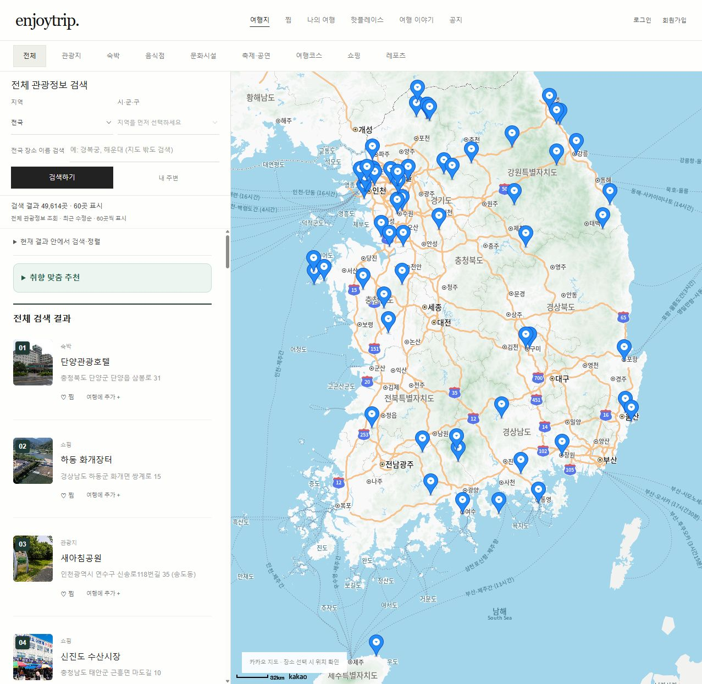
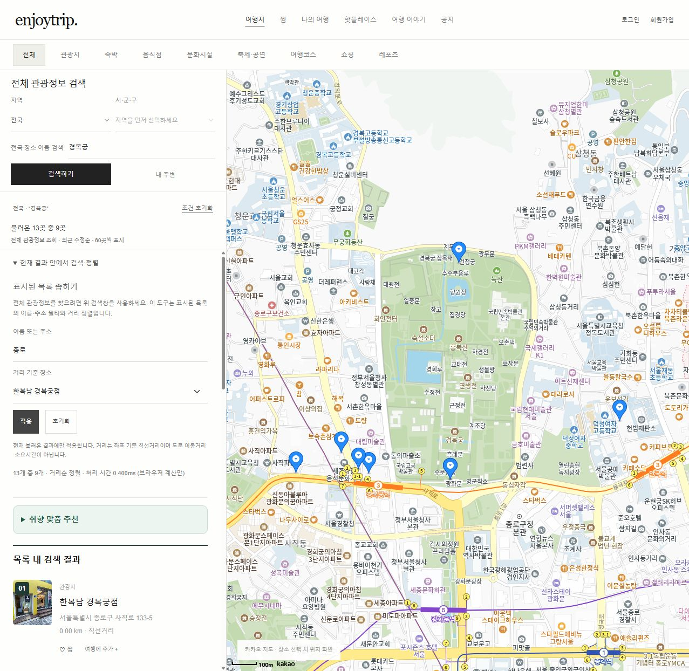
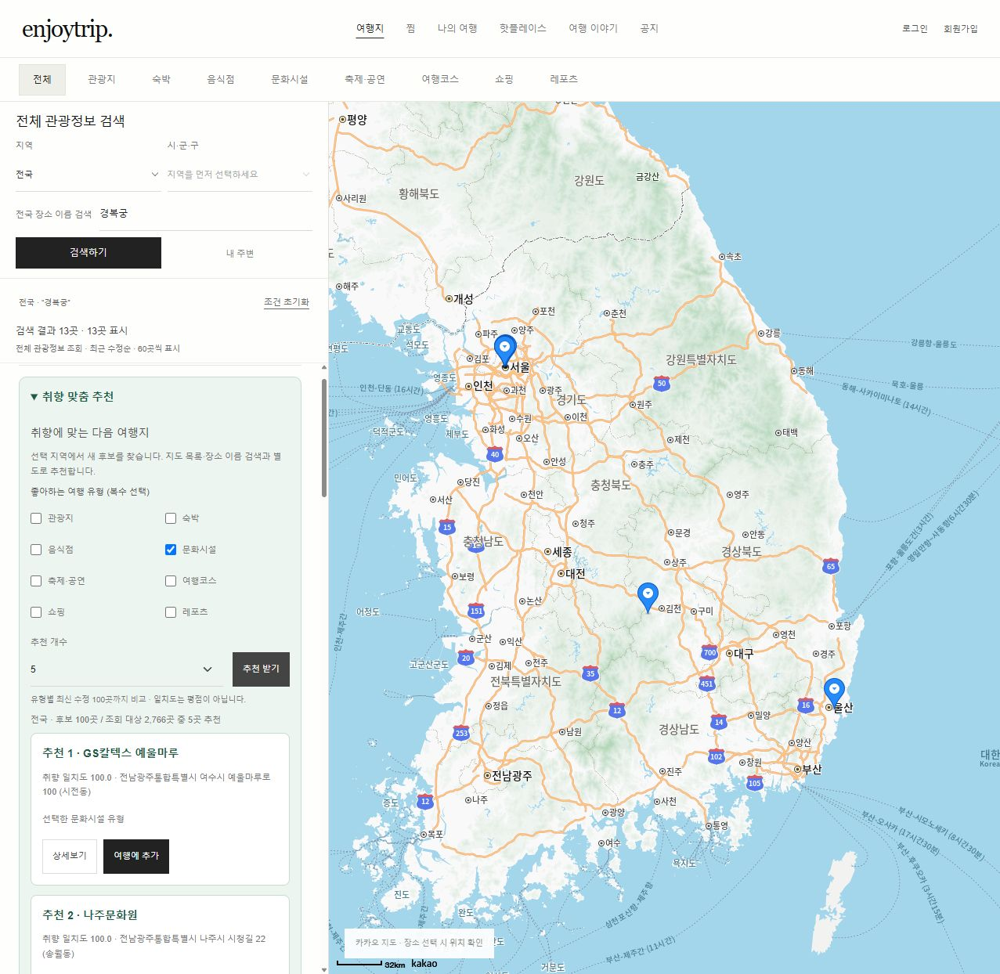

# EnjoyTrip · Algorithm EP4

참여자: **이가은 · 정제영 (A12)**

국내 여행지를 지도에서 찾고, 불러온 장소를 검색·정렬해 취향에 맞는 여행계획을 만드는 프로젝트입니다. 기존 EnjoyTrip 지도 중심 화면에 **KMP 검색 · 안정 병합 정렬 · 코사인 유사도 추천**을 적용했습니다.

- 서비스: [enjoytrip.pages.dev](https://enjoytrip.pages.dev/#explore)
- 제출 저장소: [algo_A12_gaeun_jay](https://lab.ssafy.com/aia1235/algo_A12_gaeun_jay)
- 기반 프론트: [front_A12_jayjae](https://lab.ssafy.com/aia1235/front_A12_jayjae)
- [알고리즘 기획서 PDF 바로 보기](docs/EnjoyTrip_알고리즘_적용_기획서.pdf)

## 왜 EnjoyTrip을 사용하나요?

여행지를 찾는 데서 끝나지 않고 **검색 → 취향 추천 → 여행에 담기 → 순서 조정 → 일정 복사**를 한 화면 흐름으로 연결합니다. 로그인 없이 초안을 만들 수 있고, 새로고침해도 이 브라우저에서 이어서 편집할 수 있습니다. 완성한 일정은 메신저·메모로 복사해 옮깁니다. 계정별 저장은 로그인 후 이용합니다.

### 반복 UX 검증 및 개선

- 모바일 검색 중에는 지도를 접어 결과 공간을 확보하고, 검색 후 목록에 집중합니다. `지도 보기`로 언제든 돌아갑니다.
- 작은 화면에서도 방문 순서 변경·제거를 44px 버튼으로 조작합니다. 낮은 가로 화면은 사이드바 전체를 스크롤합니다.
- 동일 관광 API 요청은 60초 동안 재사용하고 동시 요청은 하나로 합칩니다. 메모리 보관은 최대 64건이며 실패 응답은 저장하지 않습니다.
- [기기 크기별 검증 기록](docs/ux-audit.md): 360×740, 390×844, 768×1024, 844×390, 1440×900. 브라우저 화면 크기 검증이며 실물 기기·모든 브라우저 인증을 뜻하지 않습니다.

## 검색·추천 UI 개선

- **전체 관광정보 검색**: 지도에 보이는 장소와 관계없이 관광 API에서 검색합니다. 지역·시군구·유형 조건을 적용합니다.
- **현재 결과 안에서 검색·정렬**: 불러온 목록에 KMP와 거리순 정렬을 적용합니다.
- **취향 맞춤 추천**: 별도 API 후보를 조회하고 초록색 영역에 `추천 1`, `추천 2` 순위와 이유를 표시합니다. 유형별 최대 100곳이며 전체 전수 비교는 아닙니다.
- **목록 가독성**: 제목 가나다순 대신 최근 수정순으로 60곳씩 표시하고 더 보기로 이어서 조회합니다. 사진이 있는 카드에도 번호를 항상 표시합니다.

## 화면과 사용 흐름

상단에서 관광 유형을 선택하고 왼쪽에서 지역·시군구·장소 이름을 조회합니다. 추가 알고리즘은 왼쪽 목록의 접이식 메뉴에서 사용할 수 있습니다. 운영 화면에서는 Java 서버 없이 브라우저에서 실행됩니다.



### 1. 이름·주소 검색과 거리순 정렬

1. 관광지 목록을 불러온 뒤 **현재 결과 안에서 검색·정렬**을 펼칩니다.
2. 이름·주소 검색어와 거리 기준 장소를 고르고 **적용**을 누릅니다.
3. KMP로 일치하는 장소를 찾고, Haversine 거리와 안정 병합 정렬로 가까운 순서대로 표시합니다.
4. **초기화**를 누르면 원본 목록과 더 보기 상태를 복구합니다.



> 최신 운영 검증: 전체 이름 검색 `경복궁`으로 13곳을 조회한 후, 목록 내 `종로` 검색과 `한복남 경복궁점` 기준 거리순 정렬로 9곳을 표시했습니다. 좌표 기준 직선거리이며 도로 이동거리는 아닙니다.

### 2. 취향 맞춤 여행지 추천

1. **취향 맞춤 추천**을 펼쳐 좋아하는 유형과 추천 개수(3·5·10)를 선택합니다.
2. **추천 받기**를 누르면 유형 선호와 현재 여행 구성을 반영한 코사인 유사도 순으로 추천합니다.
3. 카드에서 취향 일치도와 추천 이유를 확인하고 상세보기·여행에 추가를 사용할 수 있습니다.
4. 이미 담은 장소와 중복 후보는 제외하며, 선호가 없으면 유형 선택을 안내합니다.



> 최신 운영 검증: 경복궁 검색 결과 13곳과 독립적으로 전국 문화시설 후보 100곳(조회 대상 2,766곳)을 조회해 GS칼텍스 예울마루 등 5곳을 추천했습니다. 점수는 유형 선호 일치도이며 만족 확률이나 실제 평점이 아닙니다.

위 시연 캡처는 UI 개선 후 2026-10-15 운영 실데이터 기록입니다. [최신 검증 기록](docs/ux-update.md)에서 조회 범위와 테스트를 확인할 수 있습니다. API 데이터와 조회 순서가 바뀌면 장소·개수도 달라질 수 있습니다. 찜·여행계획·게시판 등 기존 기능은 그대로 연결됩니다.

## 산출물

| 산출물 | 내용 |
|---|---|
| [알고리즘 적용 기획서 PDF](docs/EnjoyTrip_알고리즘_적용_기획서.pdf) | 지정 양식의 기획서 #1 검색, #2 거리 정렬, #3 추천 및 검증 부록 |
| [기획서 Markdown](docs/algorithm-proposals.md) | 기획서 원문과 요구사항 대응 |
| [복잡도·성능 보고서](docs/algorithm-plan.md) | 검색·정렬 100/1,000/10,000개 시간·할당 메모리 실험 |
| [추천 상세 설계](docs/recommendation-plan.md) | 사용자 벡터·점수식·추천 이유·한계 |
| [실험 원본](docs/benchmarks) | 결과 CSV와 실행 환경 |
| [제출·시연 안내](docs/submission.md) | 실행과 기능 확인 순서 |

## EP4 요구사항 반영

| 번호 | 요구사항 | 구현·산출물 |
|---|---|---|
| F401 | 기존 기능 분석 및 2가지 이상 알고리즘 선정 | 이름·주소 탐색, 거리 정렬, 추가 취향 추천의 필요성과 선택 이유 |
| F402 | 첫 번째 알고리즘 구현·테스트 | Java·JavaScript KMP, prefix 재사용, 이름·주소 독립 탐색 |
| F403 | 다른 유형 알고리즘 구현·테스트 | Java·JavaScript 안정 병합 정렬, Haversine 거리 사전 계산 |
| F404 | 이론·실측 성능 분석 및 개선 | Big-O, 100/1,000/10,000개 시간·할당 메모리, 기준선 비교 |
| F405 | 알고리즘 적용 기획서 | 지정 양식의 3개 기획서와 검증·성능 부록 |
| 추가 기능 | 취향 맞춤 추천 | JS 콘텐츠 기반 코사인 유사도, 담은 장소 제외, 추천 이유 |

Java 검사 **2,064개**, 브라우저 알고리즘 검사 **2,014개**, 추천 검사 **212개**, HTTP 통합 사례 **12개**를 검증했습니다. 기존 지도·찜·여행계획·게시판 UI와 새 기능의 연결도 브라우저에서 확인했습니다.

## 실행

필수 환경은 **Node.js 22 이상, JDK 21 이상**입니다. `java`와 `javac`가 PATH에서 실행되어야 합니다. 별도의 npm 의존성 설치는 필요 없습니다. ZIP을 풀거나 최신 main을 체크아웃한 프로젝트 루트에서 실행합니다.

```sh
git clone https://lab.ssafy.com/aia1235/algo_A12_gaeun_jay.git
cd algo_A12_gaeun_jay
npm run build
npm test
npm run serve:java
```

http://127.0.0.1:8001 에 접속합니다. `serve:java`는 Java를 컴파일하고 dist를 빌드한 뒤 같은 주소에서 정적 파일과 알고리즘 API를 제공합니다. 다른 포트는 `npm run serve:java -- 8002`로 지정합니다.

### API 키 설정

키 없이도 샘플 데이터로 알고리즘을 시연할 수 있습니다. 실시간 관광정보와 Kakao 지도는 본인의 키가 필요합니다. **Java 실행·dist 빌드는 아래 환경변수를 읽으며 `01_api/js/keys.js`를 복사하지 않습니다.**

```powershell
$env:DATA_GO_KR_API_KEY = '본인의 관광정보 인증키'
$env:KAKAO_MAP_KEY = '본인의 Kakao JavaScript 키'
npm run serve:java
```

카카오 허용 도메인에 실제 실행 주소를 등록합니다. 원본 HTML을 Python/Live Server로 여는 경우에만 `keys.example.js`를 `keys.js`로 복사하여 설정합니다. 운영 사이트에서는 KMP·병합 정렬을 브라우저 JavaScript로 실행합니다. 로컬 Java 서버에서는 기존 Java API를 사용하며, 로컬 정적 서버의 API가 없으면 브라우저 구현으로 전환합니다. 키 파일은 Git에 포함하지 않습니다.

## 사용·시연 순서

1. 상단 유형 메뉴와 왼쪽 지역·시군구·장소 이름으로 관광지를 불러옵니다.
2. **현재 결과 안에서 검색·정렬**을 펼칩니다. 샘플 14개에서 이름 또는 주소 `종로`, 거리 기준 `경복궁`을 선택하면 6개가 거리순으로 표시됩니다. 초기화로 원본 목록을 복구합니다.
3. **취향 맞춤 추천**을 펼칩니다. 문화시설·음식점을 선택하고 추천 받기를 누르면 샘플의 박물관·한식당이 추천되며 추천 이유가 표시됩니다.
4. 현재 여행에 담은 장소가 있으면 해당 유형 분포도 추천에 반영합니다. 이미 담은 장소는 제외합니다. 취향도 담은 장소도 없으면 유형 선택을 안내합니다.
5. 장소 상세·찜·여행에 추가를 사용합니다. 나의 여행에서 방문 순서·날짜·경비·메모를 저장하고 수정할 수 있습니다.

KMP 검색·거리 정렬은 **현재 불러온 목록**을 대상으로 합니다. 상단 전체 검색은 관광 API를 새로 조회합니다. 추천은 선택 지역에서 선호 유형 및 담은 장소 유형별 최근 수정 후보를 최대 100곳씩 별도로 조회합니다. 지도·검색 카드 목록에 한정되지 않으며, 전국 전체 데이터의 전수 비교는 아닙니다. 거리순은 좌표 기준 직선거리이며 도로 이동거리나 최적 경로가 아닙니다.

## 운영 브라우저 실행

`js/browser-algorithms.js`에 Java와 같은 KMP, 안정 병합 정렬, Haversine 계산을 구현했습니다. 브라우저 구현 검사 2,014개(무작위 검색, 안정 정렬, 좌표 누락·검증)를 추가했습니다. 표시 시간은 실행 위치에 따라 서버 또는 브라우저 계산 시간으로 구분합니다. 기존 Java 성능 수치를 브라우저 성능으로 해석하지 않습니다.

## 알고리즘과 검증

| 기능 | 실행 위치 | 핵심 자료구조·복잡도 |
|---|---|---|
| KMP 이름·주소 검색 | 운영 JS / 로컬 Java | prefix 배열, 시간 O(M+T+N) |
| 거리순 병합 정렬 | 운영 JS / 로컬 Java | Ranked·보조 배열, 시간 O(K log K), 보조 공간 O(K) |
| 코사인 추천 | JavaScript | 유형 가중치 Map·ID Set, 시간 O(R+D+N log N), 공간 O(R+D+N) |

N은 후보 수, T는 이름·주소 총 길이, M은 패턴 길이, K는 일치 수, R은 담은 장소 수, D는 유형 수 8입니다. 세부 공간 비용과 입력 처리 범위는 기획서에 명시했습니다.

```sh
npm run check             # JS 문법·모듈·HTML 자원 검사
npm test                  # Java + 브라우저 알고리즘 + 추천 정확성 검사
npm run test:api          # Java 서버 실행 중 HTTP 통합 검사
npm run benchmark         # Java 검색·정렬 실험
npm run benchmark:existing # Java 서버 실행 중 기존 JS와 HTTP 비교
```

통합 검사 대상 변경은 TEST_URL 환경변수를 설정합니다. 성능 측정값은 특정 Windows 11·Java 21 환경의 중앙값입니다. N=10,000에서 병합 정렬은 선택 정렬 기준선보다 약 36.41배 빨랐습니다. 반복 문자열에서 KMP는 단순 탐색보다 약 7.58배 빨랐으나, 일반 짧은 문자열의 기존 JS includes는 Java HTTP 호출보다 빨랐습니다. 전체 서비스 응답 속도 향상을 주장하지 않습니다. 메모리 측정은 스레드 할당량으로 최대 heap 사용량이 아닙니다. 추천 품질과 추천 실행 시간은 별도 실측하지 않았습니다.

## 기존 프론트 요구사항

| 번호 | 반영 범위 |
|---|---|
| F101 | 지역·시군구 관광정보, 목록·지도·상세·더 보기 |
| F102·F103 | 관광지·숙박·음식점·문화시설·공연·코스·쇼핑·레포츠 유형 |
| F107·F108 | 브라우저 기반 회원 관리·로그인·학습용 비밀번호 재설정 |
| F104 | 여행 순서·날짜·경비·메모·초안·계획 저장·수정·삭제 |
| F105 | Hotplace 등록·선택적 사진·지도 연결·본인 글 삭제 |
| F109·F110 | 공지·게시판 목록·상세·작성·수정·삭제·검색 |
| 추가 UX | 비회원 찜, 여행·Hotplace 연결, 지도 중심 반응형 UI |
| F106·F111~F114 | 뉴스·날씨·사진 추천·일출·충전소 선택 기능 미구현 |

이번 **여행지 취향 추천**은 기존 프론트 명세의 **사진 추천**과 다른 기능입니다.

## 구성·저장·제한

```text
backend/src/enjoytrip/  Java 알고리즘·서버·테스트·벤치마크
js/main.js             관광지·회원·찜·여행·게시판 연결
js/algorithm-ui.js     실행 환경별 검색·정렬 UI
js/browser-algorithms.js 운영 KMP·병합 정렬·Haversine
js/recommendation*.js  코사인 추천 로직과 UI
css/style.css          배포본 지도 중심 UI
css/features.css       사이드바 추가 기능 스타일
scripts/               빌드·검사·실험 실행
docs/                  기획서 PDF·Markdown·검증 결과
```

회원·여행계획·초안·Hotplace·게시글·찜은 localStorage, 로그인 상태는 sessionStorage에 저장합니다. 찜은 현재 브라우저 공용 목록입니다. 서버 인증·공유 DB·실제 이메일 본인인증은 없습니다. Java 서버는 로컬 알고리즘 처리용이며 127.0.0.1에 바인딩하고 dist 내부 파일만 제공합니다. 추천은 현재 페이지의 명시적 선호와 현재 여행 목록을 사용하며 타 사용자 기록을 수집하지 않습니다.

## 배포와 제출 상태

- [운영 사이트](https://enjoytrip.pages.dev/)의 배포 브랜치는 `design/kuad-reference`입니다.
- EP4 코드와 산출물은 [PR #2](https://github.com/jayyeong/enjoytrip/pull/2)를 통해 main에 병합했습니다. 이 저장소는 해당 코드를 기반으로 한 SSAFY 알고리즘 제출본입니다.
- Cloudflare Pages에서는 검색·거리 정렬·추천을 모두 브라우저에서 실행하므로 Java 서버 호스팅 없이 사용할 수 있습니다. Java 구현과 기존 성능 실험은 과제·로컬 검증용으로 유지합니다.
- CI는 정적 검사·빌드, Java·브라우저 알고리즘·추천 검사, HTTP 통합 검증을 수행합니다. 운영에서는 실제 관광 API 조회와 Kakao 지도 표시를 확인했습니다. 로컬 검증은 키 없이 샘플 모드를 사용했습니다.
- [기존 프론트 GitLab](https://lab.ssafy.com/aia1235/front_A12_jayjae)은 참고 링크입니다. EP4 제출 대상과 반별 규칙은 수업 안내를 따릅니다.

## 최종 배포 검증 (2026-10-15)

이전 검증 기준 코드: `00cd1103462457b996408cee5cf26953bf170c25` (`main` 및 `design/kuad-reference`). Cloudflare Pages 배포 성공 후 운영 브라우저에서 확인했습니다. 이후 문서 수정 커밋은 실행 코드를 변경하지 않습니다.

- 실시간 관광 API: 총 49,614개 표시, 첫 목록 24개 로드 및 Kakao 지도 마커 표시. 데이터 수와 순서는 API 변경에 따라 달라질 수 있습니다.
- 목록 검색·정렬: `공주시` + 기준 `가가상점` → 가가상점 0.00km, 가가책방 0.09km. 초기화하면 24개 복구.
- 추천: `문화시설` 선택 → 가가책방·가나아트센터, 취향 일치도 100.0 및 선택 이유 표시.
- 검증 화면: [검색·정렬](docs/screenshots/ux-sort.jpg), [추천](docs/screenshots/ux-recommendation.jpg).

최종 ZIP에는 소스, 테스트, 기획서 PDF·원문, 성능 CSV, 시연 안내와 운영 화면을 포함합니다. 빌드 결과·실제 API 키·Git 이력은 제외합니다.
