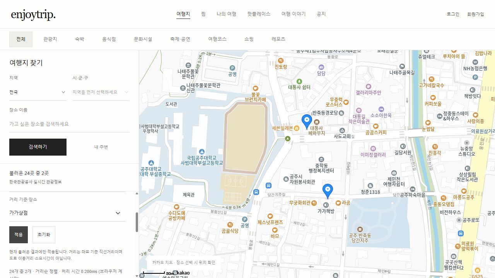
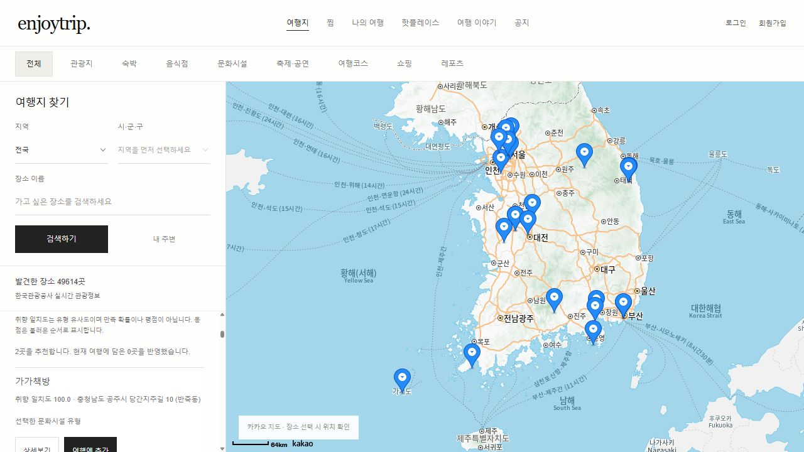

# 최종 제출·시연 안내

A12 이가은 · 정제영 | 2026-10-15

## 제출 구성

- README: 요구사항 F401~F405, 기능·실행·제한 설명
- [기획서 PDF](EnjoyTrip_알고리즘_적용_기획서.pdf): KMP·병합 정렬·코사인 추천 3개 기획서와 검증·성능 부록, 총 5쪽
- [기획서 원문](algorithm-proposals.md), [성능 보고서](algorithm-plan.md), [추천 설계](recommendation-plan.md)
- backend·js·scripts: Java와 브라우저 구현, 정확성 검사·HTTP 검사·벤치마크
- benchmarks: 성능 실험 원본 CSV·환경
- screenshots/production-*.png: 최신 운영 검증 화면

ZIP은 enjoytrip 폴더를 루트로 한다. dist·build·node_modules·Git 이력·실제 키 파일은 제외한다. 압축 해제 후 npm run build로 배포용 파일을 생성한다. 소스 기준 커밋은 00cd1103462457b996408cee5cf26953bf170c25이며 문서는 최신 배포 검증을 반영했다.

## 운영 시연

1. https://enjoytrip.pages.dev/#explore 접속. 지도와 관광지 목록을 확인한다.
2. 현재 결과 안에서 검색·정렬을 펼쳐 이름·주소를 검색하고 기준 장소를 선택한다. 현재 불러온 목록에 적용된다.
3. 검증 당시 24개에서 공주시 + 가가상점은 2개를 반환했다: 가가상점 0.00km, 가가책방 0.09km. 초기화로 24개를 복구했다.
4. 취향 맞춤 추천에서 문화시설을 선택하면 가가책방·가나아트센터의 일치도 100.0과 추천 이유를 확인했다. 실데이터 변경에 따라 결과는 달라질 수 있다.
5. 추천의 상세보기·여행에 추가를 사용한다. 담은 장소는 다음 추천에서 제외한다.





## 로컬 Java 과제 검증

Node.js 22+, JDK 21+ 및 PATH 설정이 필요하다. npm 의존성 설치는 필요 없다.

```sh
npm run build
npm test
npm run serve:java
```

http://127.0.0.1:8001 접속. 키 없이 샘플 모드에서 종로 + 경복궁 기준은 14개 중 6개다. 별도 터미널에서 npm run test:api를 실행한다. npm test는 Java 2,064개·브라우저 알고리즘 2,014개·추천 212개, HTTP 검사는 12개 사례를 검증한다.

운영은 브라우저 JS, 로컬 Java 서버는 Java API를 사용한다. 기획서의 성능 수치는 로컬 Java 실험이며 운영 브라우저 속도로 해석하지 않는다. 거리순은 직선거리, 추천 점수는 유형 선호 일치도다. 학교 시스템 업로드는 별도로 수행한다.
