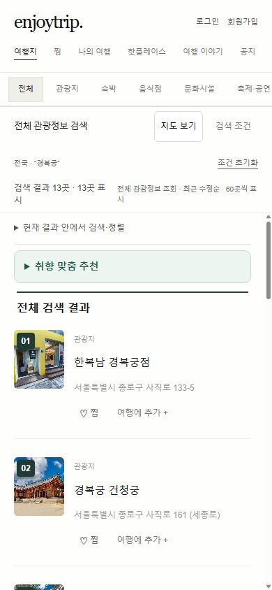
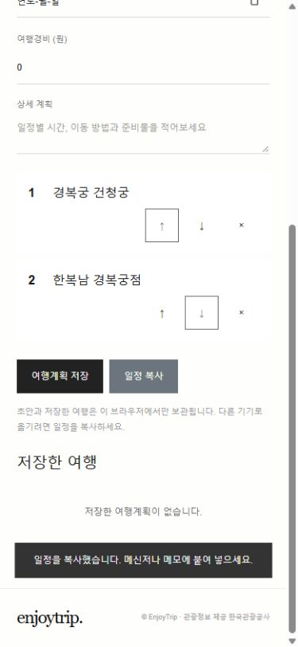
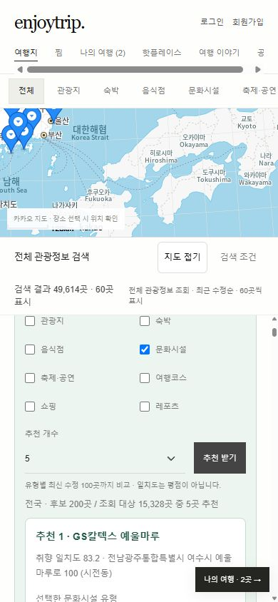

# 반복 UX 점검과 개선

2026-10-15 · 이가은 · 정제영 (A12)

## 사용자 가치

관광정보 검색·추천에서 여행 초안 작성과 일정 복사까지 연결한다. 계정 없이 시작하고 브라우저에서 이어서 편집할 수 있다. 로그인 시 작성 중인 초안을 유지하며, 계정별 저장은 기존 저장 흐름을 사용한다. 저장은 서버 동기화가 아닌 현재 브라우저 로컬 저장이다.

## 1차: 운영 모바일 관찰 → 수정 → 재검증

390×844 운영 화면에서 검색 조건을 펼치면 지도와 검색창 때문에 결과가 거의 보이지 않았다. 모바일 지도를 26% 높이로 줄이고 접기/보기 버튼을 제공했다. 검색 조건을 펼치면 지도를 숨기고 검색 제출 후 조건을 닫아 결과 영역을 확보한다. 360×740의 빈 결과 상태에서 목록 높이 약 435px, 문서 가로 넘침 없음을 확인했다.

## 2차: 여행 계획 실제 사용 → 수정 → 재검증

장소 하나를 담을 때부터 로그인창이 떠 시작을 방해했다. 게스트 초안, 자동 보관, 일정 복사를 추가했다. 경복궁·국립중앙박물관을 담고 순서를 바꾼 뒤 새로고침했을 때 순서와 여행 이름이 유지됨을 확인했다. 일정 복사 성공 안내를 확인했다. 작은 화면의 버튼 줄바꿈을 수정해 조작부를 정렬했다.

## 3차: 가로·태블릿·데스크톱 → 수정 → 재검증

844×390에서 검색창이 목록을 밀어 잘랐다. 낮은 화면은 사이드바 전체 스크롤로 전환해 결과 카드 접근과 상세 열기를 확인했다. 768×1024와 1440×900에서 가로 넘침이 없었고 추천·키보드 선택기의 Escape 닫기가 정상 동작했다. 360×740·390×844에서도 검색, 빈 결과, 초안 작성을 확인했다.

## 4차: 반복 요청 최적화

관광 API에 60초/최대 64건 메모리 캐시를 추가했다. 동시에 같은 키를 요청하면 하나의 요청을 공유한다. 응답을 복제해 호출자 간 데이터 변경이 섞이지 않게 하고 오류는 캐시하지 않아 바로 재시도할 수 있다. 자동 테스트로 요청 합치기, 만료, 용량 제한, 결과 격리, 실패 재시도, 서로 다른 키 병렬 실행을 검증했다. 이 검증은 실제 통신 지연이나 추천 정확도 향상 수치를 주장하지 않는다.

## 검증 범위

- npm run build / npm test: 기존 Java 2,064개, 브라우저 알고리즘 2,014개, 추천 212개 및 후보 조회·요청 캐시 통합 검사.
- 로컬 키 없는 환경에서 샘플 모드 안내 및 검색·추천·초안 흐름 확인.
- Chromium 기반 브라우저의 화면 크기 변경 검사. Safari/iOS 실물 기기 검증은 수행하지 않았다.
- 계정·게시판 데이터는 로컬 저장 구조를 유지한다. 캐시는 페이지를 닫으면 사라지며 최신 관광정보는 최대 60초 지연될 수 있다.

## 로그인·계정별 저장 추가 검증

로컬 전용 테스트 계정으로 가입 전 초안(서울 하루 여행, 국립중앙박물관 → 경복궁)이 가입 후 유지되는 것을 확인했다. 출발일을 입력해 저장한 뒤 새로고침했을 때 이름·순서·저장한 여행이 복원됐다. 운영 계정 데이터는 테스트에 사용하지 않았다.

## 최종 운영 확인 (beb883a)

- CI 및 Cloudflare 배포 성공 후 최신 파일로 다시 로드해 확인했다.
- 390×844 운영 모바일에서 경복궁 검색 후 13곳 표시, 검색 조건 자동 닫기, 지도 숨김, 결과 영역 약 539px, 가로 넘침 없음. 개선 전 같은 검색 흐름은 결과 영역 약 45px였다.
- 로그인 없이 한복남 경복궁점·경복궁 건청궁을 담고 순서를 변경했다. 서울 역사 산책이라는 제목과 변경 순서가 새로고침 후 복원됐으며 일정 복사 성공 안내를 확인했다.
- 담은 관광지 유형과 선택한 문화시설 유형을 반영해 후보 200곳 중 5곳을 추천했다. 재요청도 같은 결과를 정상 반환했다. 조회 대상 수는 API 갱신에 따라 달라진다.
- 화면 크기별 상세 검사는 로컬 샘플 환경에서 수행했고, 운영에서는 실데이터 모바일 흐름을 확인했다.

